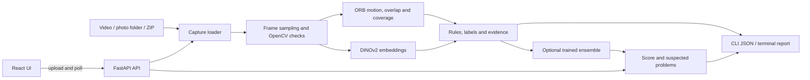

# Technical Documentation

## Overview

CaptureCheck predicts whether a video or a set of photographs is suitable for 3D Gaussian Splatting before a reconstruction run. It measures capture quality, identifies evidence-backed problems, and can produce a model score when a trained run is available.

The project is a Python analysis pipeline with a CLI and FastAPI service, plus a React browser interface. It accepts videos, photo folders, or ZIP files of photos.

## Architecture



The same `label_capture` pipeline is used by the CLI, batch labelling, review tooling, and the API. This keeps measurements and evidence consistent across interfaces.

## Tech stack

| Technology | Purpose |
|---|---|
| Python 3.11+ | Core pipeline, CLI, API, training, and tests. |
| OpenCV | Frame/video handling; sharpness, texture, overlap, motion, and coverage measurements. |
| PyTorch and torchvision | Frozen DINOv2 feature extraction and the neural score model. |
| DINOv2 (`facebookresearch/dinov2`) | 384-dimensional visual embeddings for duplicates, diversity, and reflective-surface signals. |
| NumPy, pandas, SciPy, scikit-learn | Feature processing, tabular data, and baselines. |
| FastAPI + Uvicorn | Upload API and production web server. |
| React 18, TypeScript, Vite | Browser upload and results interface. |
| ONNX / ONNX Runtime (optional model extra) | CPU-oriented exported model inference. |
| pytest and Ruff | Offline tests and linting. |

## Project structure

| Path | Description |
|---|---|
| `capturecheck/cli.py` | `capturecheck` command-line entry point. |
| `capturecheck/config.py` | Typed loading of all YAML configuration. |
| `capturecheck/io/` | Video, image-bundle, and dataset loading. |
| `capturecheck/checks/` | OpenCV quality, motion, coverage, and texture measurements. |
| `capturecheck/features/` | DINOv2 embedding and similarity calculations. |
| `capturecheck/labeling/` | Rule application, schema, aggregation, confidence, and evidence. |
| `capturecheck/model/` | Dataset construction, training, prediction, evaluation, baselines, and export. |
| `capturecheck/degrade/` | Controlled capture degradations for training data. |
| `capturecheck/api/` | FastAPI app and in-memory single-worker job queue. |
| `capturecheck/review/` | Streamlit human review interface. |
| `capturecheck/utils/` | Logging, stable seeding, and timing helpers. |
| `configs/` | Runtime, labelling, degradation, and training parameters. |
| `frontend/` | React/Vite browser application. |
| `scripts/` | Numbered data preparation, training, evaluation, and validation scripts. |
| `tests/` | Offline pytest suite. |
| `data/` | Local captures, labels, feature data, and splits; excluded from Git. |
| `models/` | Local trained model runs; excluded from Git. |
| `reports/` | Evaluation and label-agreement reports. |

## Setup and installation

### Prerequisites

- Python 3.11 or later.
- Node.js and npm for the browser interface.
- Internet access on first DINOv2 use so PyTorch Hub can download model weights. Later runs use the local PyTorch cache.

### CLI setup

PowerShell on Windows:

```powershell
cd C:\Users\pasan\OneDrive\Desktop\Ryserra\3dgs-capture-check
py -3.11 -m venv .venv
.\.venv\Scripts\Activate.ps1
pip install -e ".[dev]"
capturecheck check "C:\path\to\capture.mp4"
```

On macOS/Linux, activate with `source .venv/bin/activate` instead.

Use `pip install -e ".[api]"` when only the web/API dependencies are required. `pip install -e ".[dev]"` includes them plus training, review, test, and lint dependencies.

### Browser interface

Build and serve the production interface:

```powershell
npm --prefix frontend install
npm --prefix frontend run build
capturecheck serve
```

Open `http://127.0.0.1:8000`. API documentation is at `http://127.0.0.1:8000/docs`.

For frontend development, run these in separate terminals:

```powershell
capturecheck serve
npm --prefix frontend run dev
```

Vite serves the UI on port 5173 and proxies `/api` to port 8000.

### Common commands

| Command | Purpose |
|---|---|
| `capturecheck check <path>` | Analyse one video, photo folder, or ZIP. |
| `capturecheck serve` | Run the API and, if built, the browser UI. |
| `capturecheck label data` | Label captures in the dataset. |
| `capturecheck degrade` | Create controlled degraded copies. |
| `capturecheck splits` | Create scene-level dataset splits. |
| `capturecheck train` | Train the scoring ensemble. |
| `capturecheck evaluate` | Evaluate a trained run and write a report. |
| `make lint` / `make test` | Run checks on POSIX systems. The current Makefile uses POSIX `.venv/bin` paths. |

## External integrations and authentication

| Integration | Use | Authentication |
|---|---|---|
| PyTorch Hub / `facebookresearch/dinov2` | Downloads the pretrained DINOv2 model on first use. | No project-level credentials are implemented. Network access is required for the first download. |
| Browser client | Calls the local FastAPI API. | No authentication is implemented. Development CORS allows only `localhost:5173` and `127.0.0.1:5173` by default. |

The API writes each uploaded capture to a temporary directory and removes it when processing ends. Jobs and results are held in process memory only; server restarts discard them.

## Configuration reference

All thresholds are in `configs/`, not hard-coded in analysis modules.

| File | Controls |
|---|---|
| `configs/default.yaml` | Data/model/report paths; runtime time budget, worker count, and device preference. |
| `configs/labeling.yaml` | Sampling, image ordering, resize width, and all measurement-to-label thresholds. |
| `configs/train.yaml` | Ensemble seeds, transformer shape, pretext and ranking training, optimizer, and evaluation settings. |
| `configs/degrade.yaml` | Synthetic degradation operations, strengths, output JPEG quality, and seed. |

| Environment variable | Effect |
|---|---|
| `CAPTURECHECK_CONFIG_DIR` | Replaces the directory from which the four YAML files are loaded. |
| `CAPTURECHECK_MAX_UPLOAD_MB` | API upload limit in MB; defaults to `2048`; invalid values fall back to the default. |
| `CAPTURECHECK_LOG_LEVEL` | Logging level; defaults to `INFO`. |
| `CAPTURECHECK_API` | Vite development proxy target; defaults to `http://127.0.0.1:8000`. |

## API summary

| Endpoint | Purpose |
|---|---|
| `GET /api/health` | Service capabilities, current model availability, limits, accepted types, and score bands. |
| `GET /api/labels` | Problem names and meanings from the shared Python schema. |
| `POST /api/captures` | Upload one video or photo ZIP; returns a queued job (`202`). |
| `GET /api/captures/{job_id}` | Poll job state and final result. |
| `GET /api/captures` | List jobs held in memory. |
| `DELETE /api/captures/{job_id}` | Remove an in-memory job result. |

## Known limitations

- The current evaluation report says the trained model does not yet outperform the LightGBM feature baseline (Spearman `0.46` vs `0.66` on the reported test set).
- The available evaluation data has only one test video and no usable PSNR target count, so general quality-score claims are limited.
- Synthetic degradation labels are useful training signals but are not a substitute for real reconstruction-quality targets.
- DINOv2-dependent measurements are unavailable until its weights have been downloaded; the pipeline continues without them if loading fails.
- The API processes one job at a time and retains at most 50 in-memory job records.
- Uploaded captures are not persisted, and there is no user authentication or multi-user isolation.
- The root Makefile currently assumes POSIX virtual-environment paths; Windows users should run the equivalent commands directly from an activated virtual environment.
